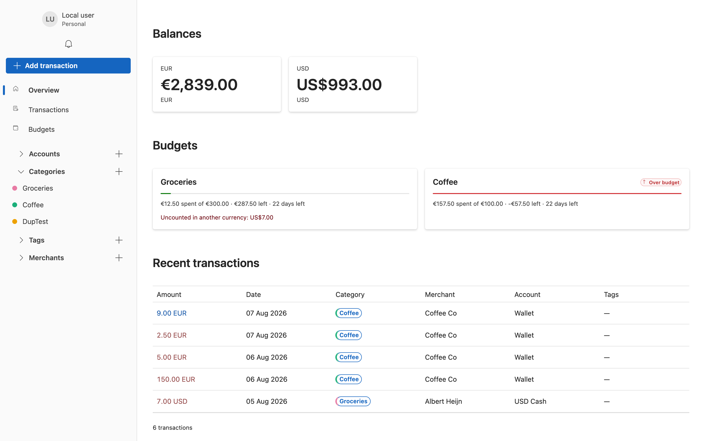

# Xpense

Xpense is a self-hosted personal-finance ledger. It records income, expenses and transfers, and reports on accounts and budgets without moving money or converting currencies.

The repository contains an ASP.NET Core API and worker in `api/`, and a React client in `web/`. Start with the [documentation index](docs/README.md), [getting started](docs/development/getting-started.md), or the [architecture overview](docs/architecture/overview.md).

Contributors should read [AGENTS.md](AGENTS.md) for repository rules and required checks.
