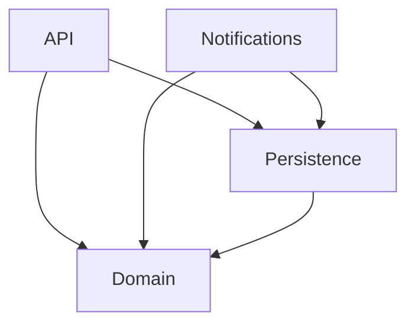
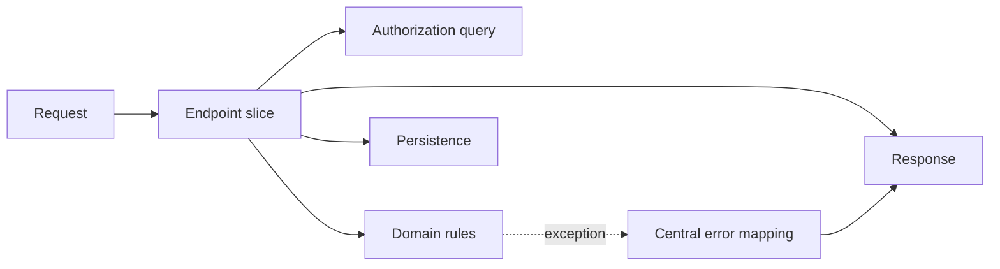
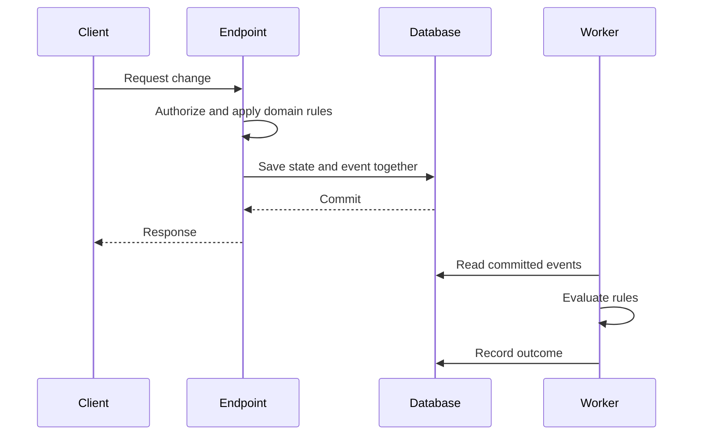

# API architecture

The API uses vertical slices. Each endpoint owns the work for one request. The domain owns business rules. Persistence owns durable state. The notification worker processes committed events.

## Projects and dependencies

Arrows show project references.

| Project | Responsibility |
| --- | --- |
| API | HTTP, feature operations, authorization, and coordination of writes. |
| Domain | Business concepts, invariants, and state transitions, independent of callers and storage. |
| Persistence | Storage mappings, database access, and migrations. |
| Notifications | Processing committed events and delivering notifications. |
| Tests | Domain, endpoint, integration, and architecture checks. |

The API and worker are separate processes. They share the database; neither calls the other directly. The domain must not depend on the API, persistence, or worker.

## Endpoint boundaries

Each endpoint owns its route, request, validation, handler, authorization, query or command, and response.

- Slices must not reference one another.
- Keep each request inside its slice.
- Keep responses shared within one feature in that feature.
- Put responses used across features in shared API contracts.

Keep invariants that apply regardless of the caller in the domain. Request validation gives useful errors but does not replace domain guards. Domain exceptions leave the slice and are mapped centrally to HTTP errors.

Duplicate similar queries and projections when that keeps slices independent. Do not extract a shared abstraction solely to remove duplication. Shared persistence behavior must have its own clear responsibility and must not couple feature workflows.

Feature endpoints use endpoint discovery. The health route is the only exception and stays outside the feature slices.

## Authorization and deletion

Authorize every private-resource operation in its query:

- Start with the current user.
- Correlate the resource, group, membership, grant, and resource type in the same query.
- Do not use visibility filters as authorization boundaries.
- Return a neutral not-found result when the caller must not learn whether a private resource exists.
- Do not return forbidden responses from feature code.

Some legacy financial tables lack per-user ownership. Their existing visibility must not be mistaken for private-resource authorization.

Ordinary user resources are soft-deleted. Memberships, grants, and invitations retain their explicit revocation states and history.

## Events and notifications

Producers record facts in the same unit of work as the change. The caller must commit: emitting an event alone does not save it. The events table is the queue. The worker processes events independently. Producers do not decide what to notify.

Each notification rule owns one kind and must not depend on another rule. Event bodies contain primitives, enums, and identifiers. Notification payloads exclude time-varying values so deduplication is stable. Budgets report spending and never block writes.

See [events and notifications](events.md) for processing and delivery.

## Deployment and enforcement

Migrations apply schema changes and reference data before the API and worker start. Neither process migrates or seeds the database at startup.

Project references and architecture tests enforce dependency and isolation rules. Integration and endpoint tests check behavior. Review authorization and domain invariants as well: structural checks alone cannot prove them. See [coding conventions](../development/conventions.md) and [testing](../development/testing.md).
