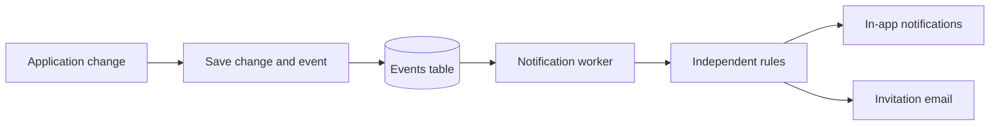

# Events and notifications

An **event** records a fact. A **notification** tells someone about a fact. The producer records the event; the notification worker decides whether to notify anyone.

## Flow

1. The producer adds the event to the same unit of work as the change.
2. The caller saves the change and event together. Emitting an event alone does not save it.
3. The worker reads committed events from the events table, which is the queue.
4. Rules evaluate the event and may create notifications or deliver invitation email.
5. The worker records the processing outcome.

An event can produce no notifications or several. The API and worker run separately; the request does not wait for notification processing.

## Boundaries

- Producers state facts. They do not decide what to notify.
- Event bodies contain primitives, enums, and IDs. They do not contain entities or domain value objects.
- Each notification rule owns one notification kind and its queries. Rules do not reference one another.
- Notification payloads contain no time-varying values. The worker hashes each payload for deduplication.
- Budgets report spending and never block a write. The server rule reports a crossing of the limit.

## Delivery and failures

The worker deduplicates in-app notifications by event ID and payload hash. Failed events are retried. After the maximum attempts, an event is marked processed and retains its error for inspection. There is no separate dead-letter table.

Invitation email uses a separate delivery record. The API and worker must share Data Protection keys to handle the protected invitation link. Email can be disabled; in that case the creator can pass the invitation link on manually.

Client-derived budget alerts have different storage and read-state behavior. See [notifications](../features/notifications.md).

For inspection, retries, and email configuration, see [event operations](../operations/events.md).
