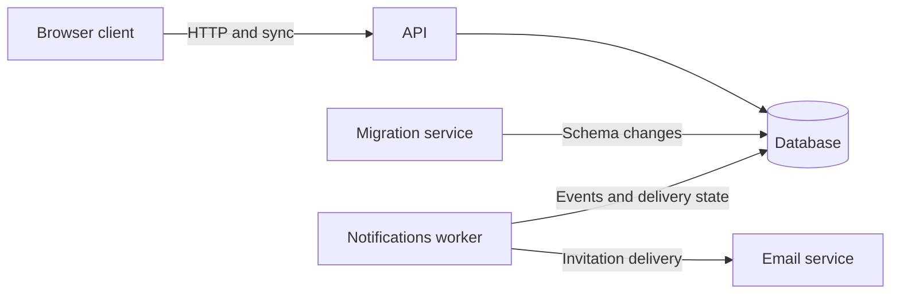

# Architecture overview

Xpense has two source trees. `api/` contains the ASP.NET Core API, domain, PostgreSQL persistence, migration tooling, notifications worker and tests. `web/` contains the React and TypeScript browser client.

The API and worker share the database. The worker processes events independently of requests. Migrations run before both processes start.

## Responsibilities

- **API:** handles requests through independent endpoint slices.
- **Domain:** owns business rules shared by callers.
- **Persistence:** stores application data and defines migrations.
- **Browser:** maintains a local projection and an outbox for sync. The server stores sync payloads as plaintext JSON.
- **Worker:** processes database events for notifications and invitation email. Events are saved with the changes that produce them.

## Read more

- [API architecture](api.md)
- [Web and sync](web-and-sync.md)
- [Events and notifications](events.md)
- [Security and privacy](security.md)
