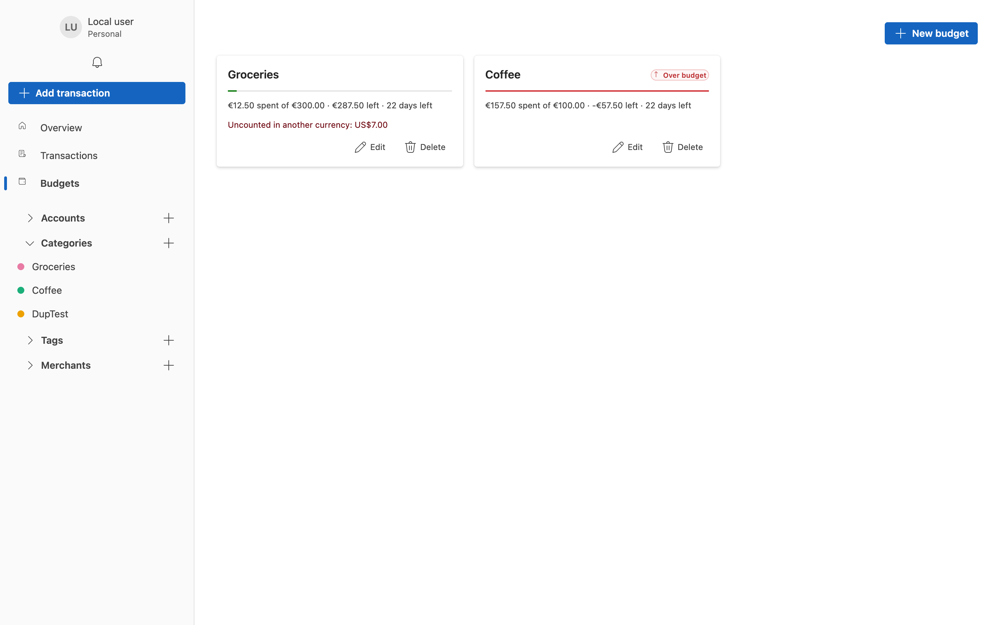

# Budgets

A budget reports spending against a limit for one category, currency, and period. It never blocks a transaction.

## Fields

| Field | Rule |
| --- | --- |
| Category | Required; cannot be changed after creation |
| Amount | Positive, with a currency |
| Recurrence | Weekly, monthly, yearly, or none |
| Start | Required |
| End | Required for a non-repeating budget; cannot precede the start |
| Alert threshold | Optional percentage from 1 to 100; defaults to 75 |

## Periods

| Recurrence | Window | Example |
| --- | --- | --- |
| Weekly | ISO week starting Monday | `2026-W32` |
| Monthly | Calendar month | `2026-08` |
| Yearly | Calendar year | `2026` |
| None | Specified start and end | `2026-08-01..2026-08-31` |

## Spending

Only expenses in the category and currency count. Spending is assigned to the period when it occurred. Income and transfers do not count. Spending in another currency is reported as uncounted; create another budget to track it.

The budget shows spent, remaining, whether the limit is exceeded, and days left. Remaining can be negative. Multiple budgets can cover the same category; each reports independently.

## Alerts

The server rule reports an over-limit crossing. The client can derive an alert from an exceeded local period. The stored alert threshold does not currently produce a notification. See [notifications](notifications.md).
