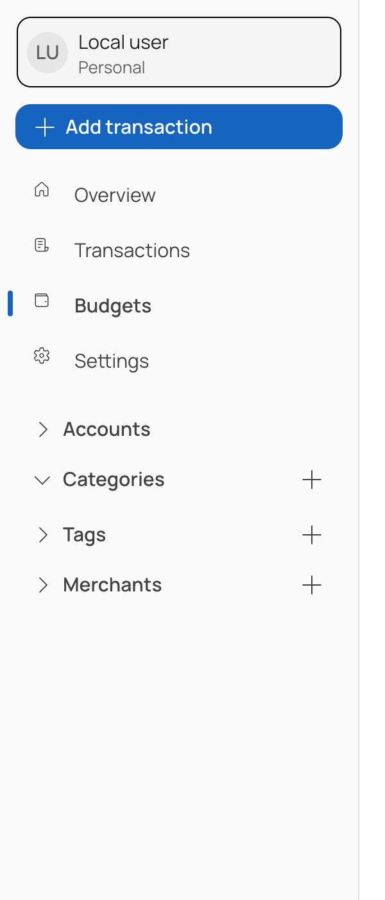

# Categories

A category describes what an income or expense transaction is for. Each such transaction has one category. Transfers have none.

Create a category with **+** beside *Categories*. Select one in the sidebar to filter transactions. Its label is required and can contain up to 200 characters.

## Necessity

Each category has one necessity level. The default is **Useful**.

| Level | Weight | Meaning |
| --- | --- | --- |
| Essential | 1 | Necessary, such as rent or staple food |
| Important | 2 | Hard to cut |
| Useful | 3 | Worth the money |
| Optional | 4 | Pleasant but easily dropped |
| Avoidable | 5 | Spending the user would rather avoid |

The levels are fixed reference data. Older names still resolve: High to Important, Medium to Useful, and Low to Optional.

## Delete

Deletion is soft. Existing transactions retain their category reference. The client also removes budgets for that category.
