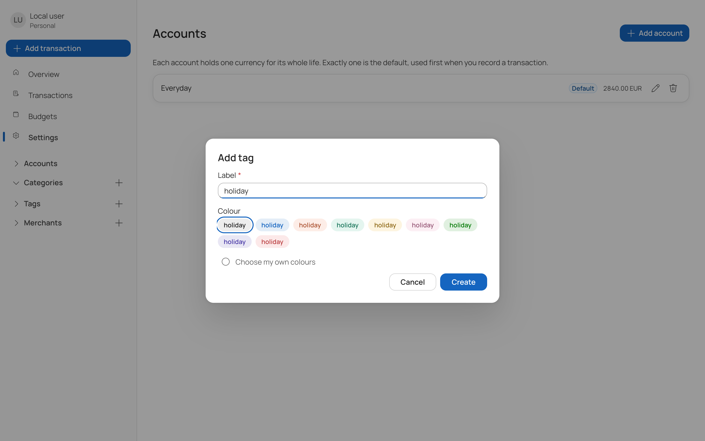

# Tags

A tag is an optional label for a transaction. Use tags for details that span categories, such as `reimbursable` or `holiday-2026`.

## Create and edit

- A transaction can have any number of tags.
- A label is required and can contain up to 100 characters.
- Create a tag from the sidebar or enter a new label in the transaction form.
- Choose a preset colour pair or enter custom foreground and background colours.
- Custom colours accept three or six hexadecimal digits, with or without `#`.

## Filter and delete

Select a tag in the sidebar to filter transactions. Tag filters combine with the other filters. Deleting a tag is soft: transaction history remains, and a filter for the deleted tag is removed.
