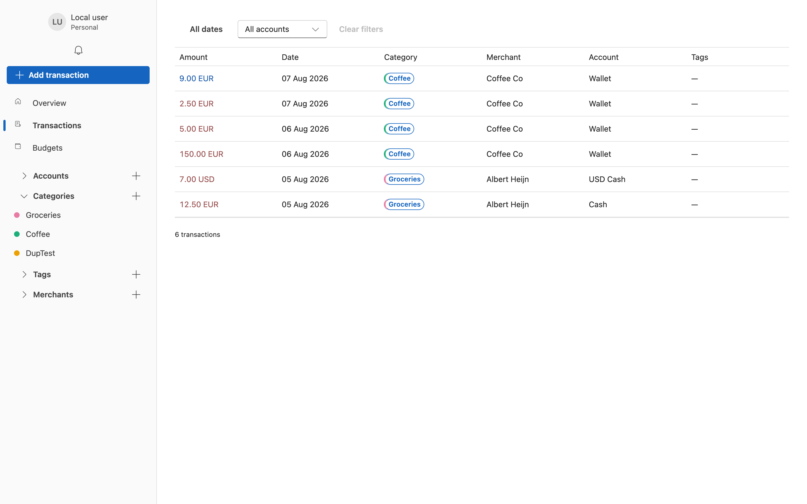

# Transactions

A transaction records money that has already moved. Its source and destination determine its kind.

## Kinds

| Kind | Source | Destination | Category and merchant |
| --- | --- | --- | --- |
| Income | Outside Xpense | Account | Required |
| Expense | Account | Outside Xpense | Required |
| Transfer | Account | Another account | Not allowed |

Transfers are not spending and do not count against budgets.

## Fields and rules

- The amount must be positive and use the account's currency.
- A transfer needs two distinct accounts in the same currency and sufficient source balance.
- Date and time record when the money moved. Tags and reason are optional.
- Income and expense require a category and a merchant.

## Quick Add

Enter a sentence such as `Spent 5 euros at Albert Heijn #shopping`. The local parser identifies transaction details and marks recognized, unresolved, conflicting, or invalid text. Review and edit the fields before saving.

## Find and change

Filter by date, account, category, tag, or merchant. Filters combine; **Clear filters** resets them. Date ranges include the start and exclude the end. Filters for deleted items are removed.

Editing reverses the old balance effects and applies the new ones. Deleting is soft; sync uses tombstones to communicate deletions. Transactions are ordered by when the money moved. The API supports paging.
